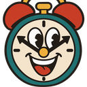
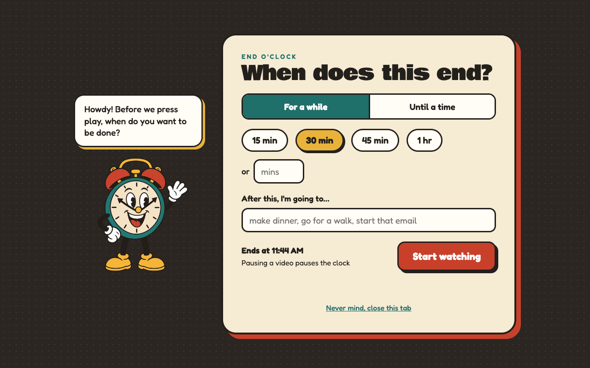
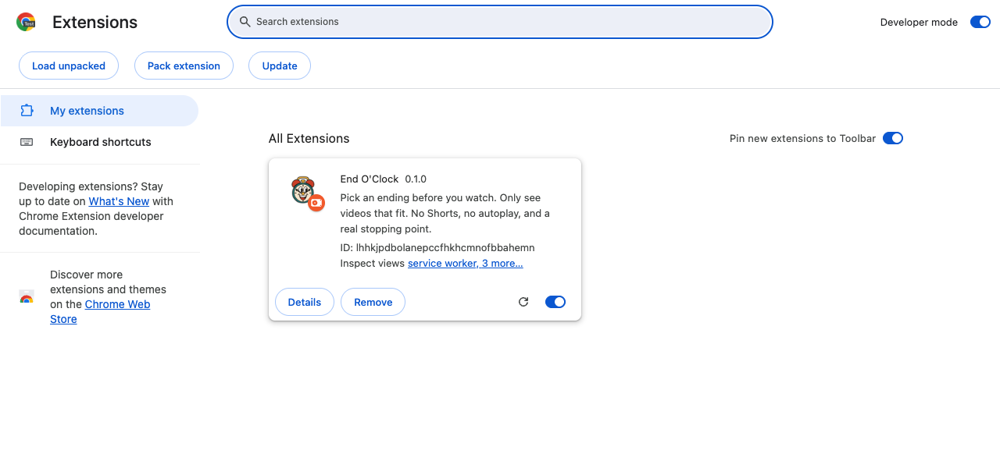
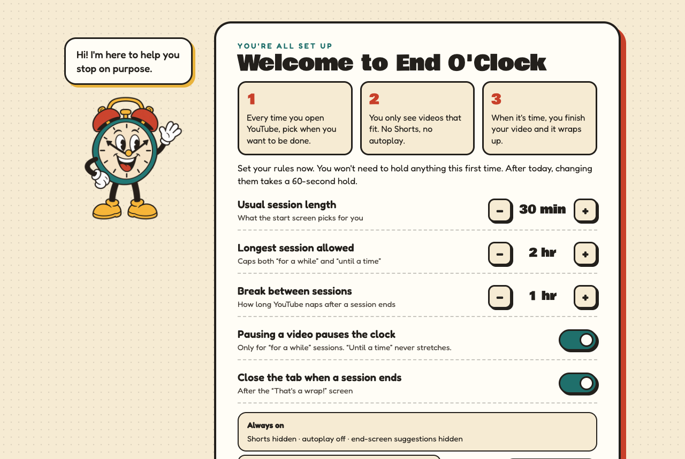
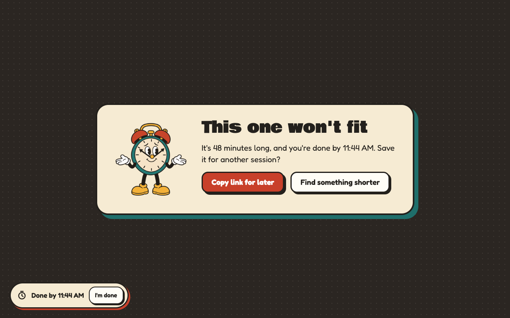
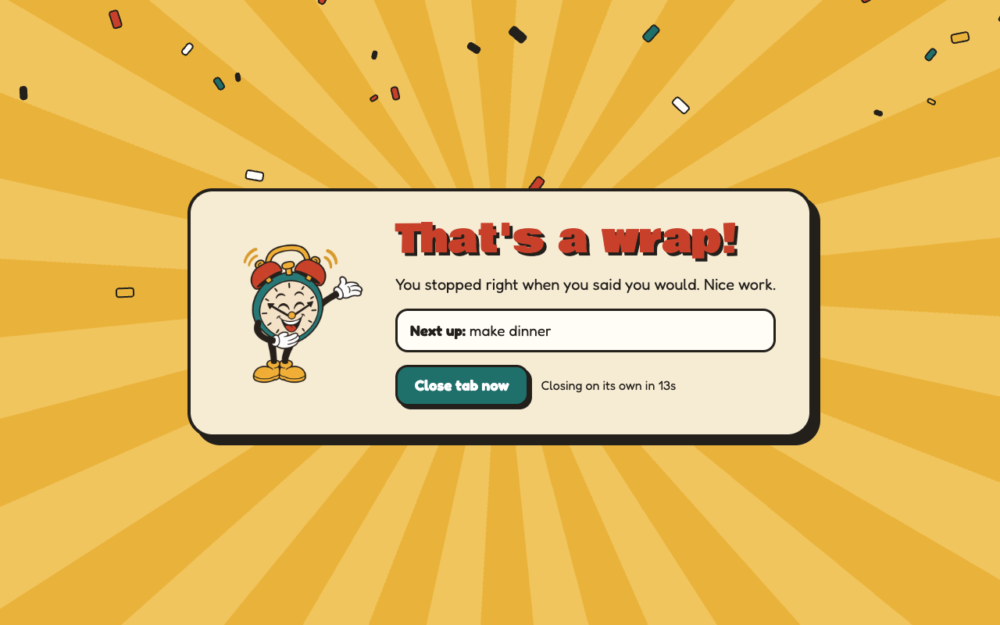
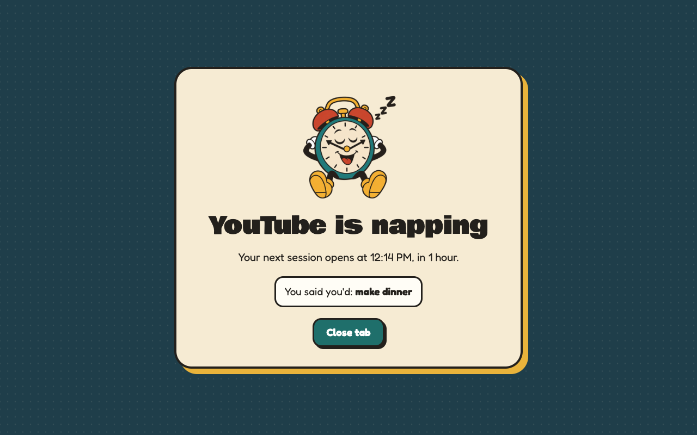
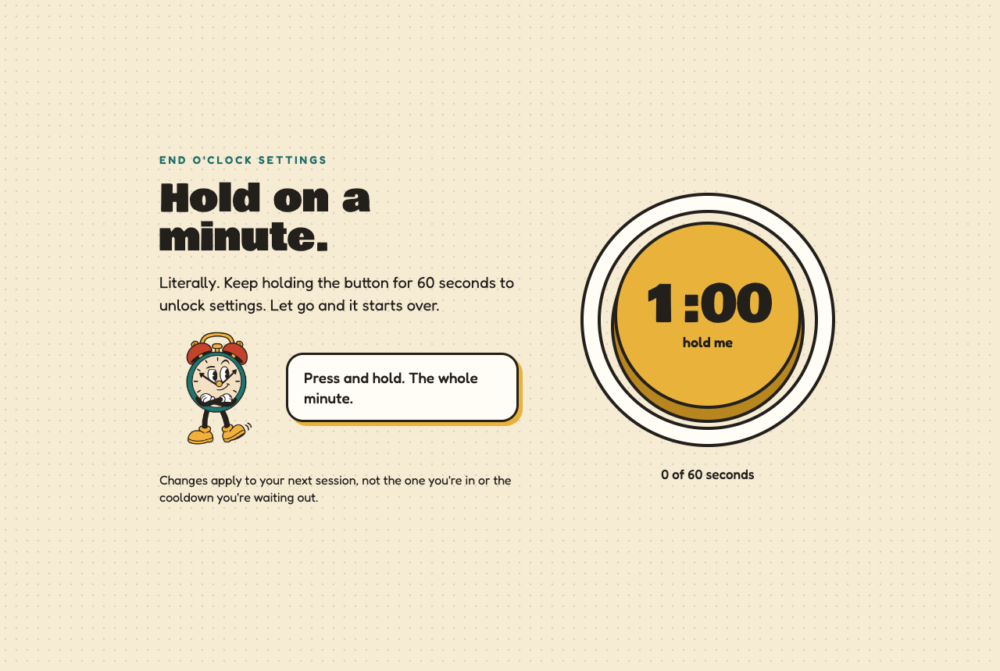

<p align="center"></p>

<h1 align="center">End O'Clock</h1>

<p align="center"><b>Pick an ending before you watch YouTube. Only see videos that fit. Stop on a high note.</b><br>
Free, open source, and it never collects anything about you.</p>

<p align="center"></p>

## ⬇️ [Download End O'Clock](https://github.com/colshefsky/end-oclock/releases/latest/download/end-oclock.zip)

Works in **Chrome, Edge, Brave, Opera, Vivaldi, Arc, Ardia** and other Chromium-based browsers. Setup takes about two minutes, and you'll only do it once.

---

## How to install (step by step)

> End O'Clock isn't in the Chrome Web Store yet, so you add it yourself. It's safe and takes a few clicks.

**1. Download it.** Click **[Download End O'Clock](https://github.com/colshefsky/end-oclock/releases/latest/download/end-oclock.zip)**. A file called `end-oclock.zip` lands in your Downloads.

**2. Unzip it.** Double-click `end-oclock.zip`. You'll get a folder called **end-oclock**.
Move that folder somewhere it can stay for good, like your **Documents** folder. (If you delete the folder later, the extension goes away too.)

**3. Open your browser's extensions page.** Copy the address for your browser, paste it into the address bar, and press Enter:

| Browser | Paste this |
|---|---|
| Chrome | `chrome://extensions` |
| Edge | `edge://extensions` |
| Brave | `brave://extensions` |
| Opera | `opera://extensions` |
| Vivaldi | `vivaldi://extensions` |
| Arc / Ardia / others | `chrome://extensions` |

**4. Turn on "Developer mode".** It's a switch at the top right of the page (in Edge, it's on the left side).



**5. Click "Load unpacked"** (top left), then pick the **end-oclock** folder from step 2 and click **Select**.

**6. Pin it.** Click the puzzle-piece icon in your toolbar, then the pin next to **End O'Clock**, so our little clock is always there.

**7. Say hi.** A welcome page opens where you set your rules. Next time you open YouTube, the clock will ask when you want to be done.



### Is this safe?

Yes. End O'Clock is open source, so anyone can read every line of it here. It doesn't collect, send or sell anything. Everything stays in your browser ([privacy details](PRIVACY.md)). It only runs on youtube.com.

### Updating

When there's a new version: download the zip again, replace the files in your **end-oclock** folder with the new ones, then press the ↻ reload arrow on End O'Clock's card on the extensions page.

### Good to know

- Extensions you add this way don't update by themselves (see "Updating" above).
- Some browsers show a reminder about "developer mode extensions" now and then. That's normal for extensions added this way; you can dismiss it.
- Anyone can turn the extension off on the extensions page. End O'Clock adds friction, not locks.

---

## What it does

- **You pick an ending first.** Every visit to YouTube starts with "When does this end?": for a while (15 min, 30 min, 1 hr…) or until a time (like 10:00 PM). You can add what you're doing next ("make dinner").
- **You only see videos that fit.** Anything longer than the time you have left is hidden everywhere: home, search, the sidebar, channels. So there's nothing to rush and no countdown to stare at.
- **No Shorts, no autoplay.** Shorts are gone everywhere, autoplay is off, and the "watch next" suggestions at the end of videos are hidden.
- **It ends gracefully.** A video you started always gets to finish. Then you get a little celebration and a reminder of what's next.
- **A break between sessions.** After a session, YouTube naps for a while (you choose how long).
- **Settings take a whole minute to open.** You hold a button for 60 seconds. If you let go, it starts over. The rules you set when you're calm hold up when you're not.

| | |
|---|---|
|  |  |
|  |  |

A few details: pausing a video can pause the clock (a setting) but never past your longest session. If you pause for more than two minutes after time's up, that counts as stopping. Live streams wrap up right at your end time, since they have no ending of their own.

## Where this came from

End O'Clock was inspired by Hank Green's video launching Clockwise TV, an app for kids that plans the end of every session and never shows a video that would run past it, and by the hundreds of comments asking for a grown-up version. This is that grown-up version for YouTube, without any curated content. **It is not affiliated with Clockwise TV, Hank Green, or YouTube.**

## License

[MIT](LICENSE). The fonts are Bowlby One and Fredoka (SIL Open Font License, included). The Shorts-hiding rules adapt the MIT-licensed [ublock-hide-yt-shorts](https://github.com/gijsdev/ublock-hide-yt-shorts) list.

---

## For developers

Built with [WXT](https://wxt.dev) and TypeScript, Manifest V3.

```bash
npm install
npm run dev        # opens a browser with the extension loaded, auto-reloads
npm test           # unit tests (Vitest)
npm run build      # production build in .output/chrome-mv3
npm run test:e2e   # browser tests against saved YouTube-like pages (Playwright)
npm run zip        # release zip
```

How it fits together:

- `src/core/`: pure logic (the session rules, time, settings, reading YouTube's data). Most tests live here.
- `src/youtube/`: everything that touches YouTube. **`selectors.ts` holds every YouTube selector and data path**; when YouTube changes its page, that's usually the only file to fix.
- `src/ui/`: our screens, drawn in a Shadow DOM so YouTube's styles can't touch them.
- `src/entrypoints/`: the content scripts, background worker, popup and settings page.
- A second, read-only script runs in YouTube's own page world to read video lengths from YouTube's data. It never changes anything YouTube receives.

Before a release, run the 10-minute [live smoke test](docs/smoke-test.md). See [CONTRIBUTING.md](CONTRIBUTING.md) for the project's rules, including **mockups first** for anything visual.
